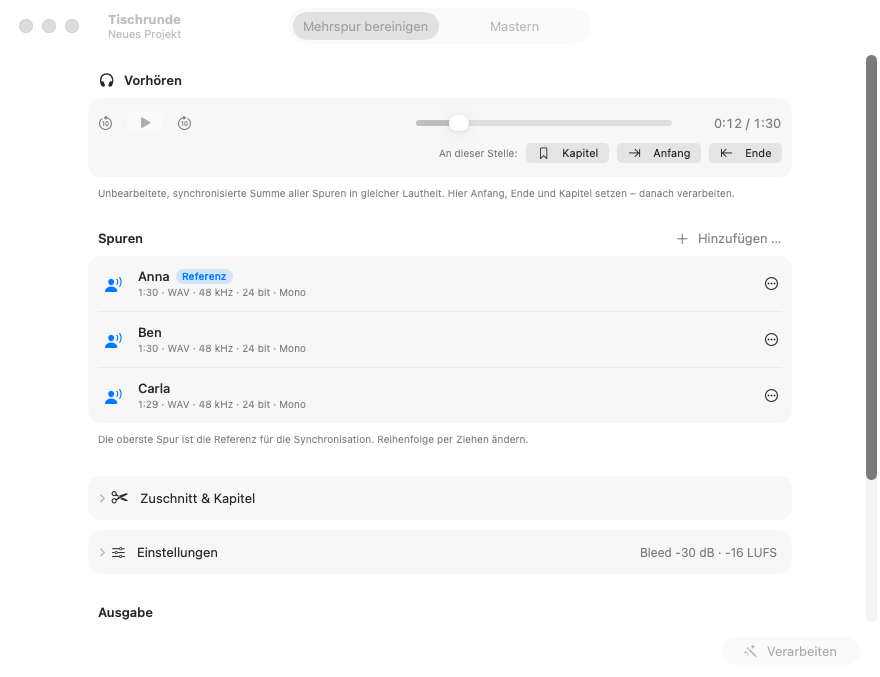
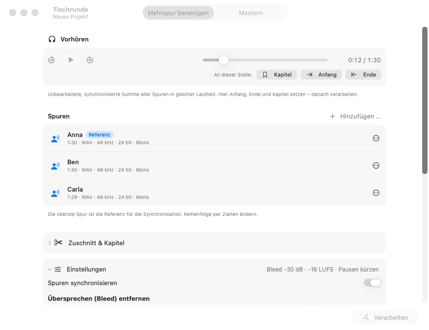
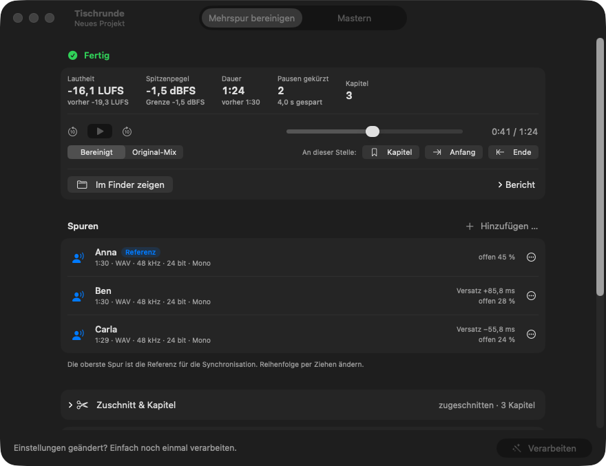
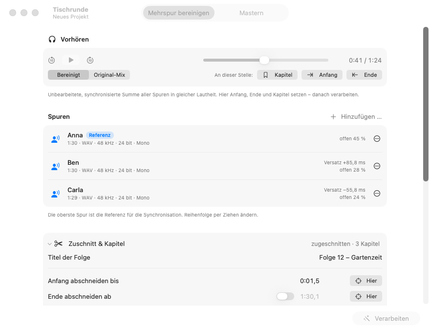
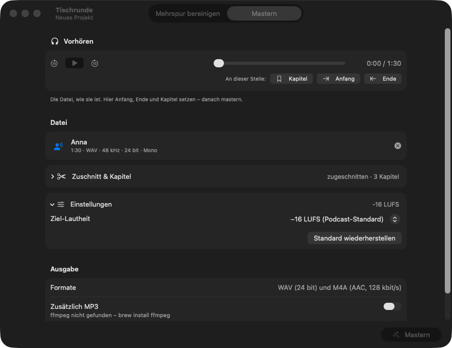

# Tischrunde

**Mehrspur-Nachbearbeitung für Podcasts, bei denen alle an einem Tisch sitzen.**
Eine schlanke, kostenlose macOS-App. Sie arbeitet komplett offline und ist Open Source (MIT).

Du ziehst die Einzelspuren deiner Aufnahme hinein, zum Beispiel eine Datei pro Person aus SonoBus. Tischrunde liefert daraus eine fertige Podcast-Datei:

- **synchronisiert** die Spuren automatisch,
- **entfernt das Übersprechen** (Mic Bleed): Jedes Mikrofon hört die anderen leise mit,
- **gleicht die Lautstärke** aller Stimmen an, auch wenn jemand mal näher oder weiter weg vom Mikro sitzt,
- **kürzt lange Pausen** auf Wunsch,
- **schneidet Anfang und Ende** zu,
- setzt **Kapitelmarken mit Namen**,
- bringt alles auf **Podcast-Lautheit** (−16 LUFS) und exportiert **M4A**, **WAV** und optional **MP3**,
- schreibt zusätzlich **bereinigte Einzelspuren** für den Feinschnitt in Audacity.

Der zweite Modus **„Mastern“** nimmt eine fertig geschnittene Datei und bringt sie nur auf die Ziel-Lautheit.



<details>
<summary>Weitere Screenshots</summary>

| | |
|---|---|
|  |  |
|  |  |

</details>

## Installation

1. Unter [Releases](../../releases) oder in den [Actions-Artefakten](../../actions/workflows/ci.yml) `Tischrunde.app` herunterladen, oder selbst bauen (siehe unten).
2. In den Ordner *Programme* ziehen.
3. **Beim ersten Start:** Die App ist nicht von Apple notarisiert. Deshalb mit **Rechtsklick → Öffnen** starten und im Dialog **Öffnen** bestätigen. Falls macOS das verweigert: *Systemeinstellungen → Datenschutz & Sicherheit → „Dennoch öffnen“*.

Voraussetzung: **macOS 26 oder neuer**, Apple Silicon oder Intel.

Für den MP3-Export wird [ffmpeg](https://ffmpeg.org) benötigt: `brew install ffmpeg`. Ohne ffmpeg ist die MP3-Option ausgegraut, alles andere funktioniert.

## Bedienung

### Mehrspur bereinigen

1. **Spuren hineinziehen.** Eine Datei pro Person (WAV, AIFF, FLAC, M4A, MP3 oder CAF). Die oberste Spur ist die Referenz für die Synchronisation. Die Reihenfolge lässt sich per Ziehen oder über das `…`-Menü ändern.
2. **Vorhören.** Nach ein paar Sekunden erscheint oben ein Player mit der unbearbeiteten, schon synchronisierten Summe aller Spuren. Mit **„An dieser Stelle: Kapitel · Anfang · Ende“** übernimmst du die aktuelle Position, ganz ohne vorher zu verarbeiten.
3. **Optional: Zuschnitt & Kapitel.** Titel der Folge, Kapitelnamen; Zeiten lassen sich auch von Hand eintippen (z. B. `1:02:30`).
4. **Optional: Einstellungen.** Die Standardwerte passen für die meisten Aufnahmen (siehe unten).
5. **Verarbeiten** (⌘R). Der Fortschritt steht unten, „Abbrechen“ ist jederzeit möglich. Die schon für die Vorschau gelesenen Spuren werden wiederverwendet.
6. **Ergebnis anhören.** Der Player zeigt jetzt das Ergebnis. Mit **„Bereinigt | Original-Mix“** vergleichst du an derselben Stelle mit der einfachen Summe der Rohspuren, gleich laut. Anfang, Ende und Kapitel lassen sich auch hier noch setzen; danach einfach noch einmal verarbeiten.
7. **„Im Finder zeigen“** öffnet den Ausgabeordner.

### Mastern

Eine fertig geschnittene Datei hineinziehen; sie lässt sich sofort anhören. Ziel-Lautheit wählen, **Mastern**. Zuschnitt und Kapitel funktionieren hier genauso.

### Projekte speichern und später weitermachen

- **Ablage → Projekt sichern** (⌘S) speichert eine `.tischrunde`-Datei mit Spuren, Einstellungen, Zuschnitt, Kapiteln und Titel. **Projekt öffnen** (⌘O) oder ein Doppelklick lädt alles wieder. Verschobene Audiodateien werden meist trotzdem gefunden.
- Zusätzlich merkt sich Tischrunde den **letzten Stand automatisch**. Du kannst die App jederzeit beenden und später an derselben Stelle weitermachen.
- Deine zuletzt benutzten Einstellungen gelten als Vorgabe für neue Projekte. **„Standard wiederherstellen“** setzt sie zurück.

### Was im Ausgabeordner landet

Standardmäßig neben der ersten Eingabedatei, im Unterordner `Tischrunde <Datum Uhrzeit>`:

| Datei | Inhalt |
|---|---|
| `Mix.m4a` | Fertige Folge: AAC 128 kbit/s, mit Titel und Kapiteln |
| `Mix.wav` | Fertige Folge, 24 bit |
| `Mix.mp3` | Nur wenn gewählt und ffmpeg installiert ist, mit Titel und Kapiteln (ID3) |
| `<Name>_bereinigt.wav` | Je Person: synchronisiert, Bleed entfernt, Pegel angeglichen, ohne Lautheitsanpassung (32 bit Float) |
| `Kapitel.txt` | Kapitel als Text (`00:12:34.567 Titel`), für Podcast-Hoster |
| `Bericht.txt` | Versätze, Offen-Anteile, Pegel, Lautheit vorher/nachher, Pausen, Warnungen |

Im Modus „Mastern“ heißen die Dateien `<Name>_gemastert.*`.

## Empfohlener Ablauf mit SonoBus

1. Alle sitzen am Tisch, jede Person mit eigenem iPhone als Mikrofon, möglichst **nah am Mund** (20–30 cm). Je näher das Mikro, desto besser wirkt die Bleed-Entfernung.
2. SonoBus auf dem Mac nimmt jede Person als **eigene Datei** auf („Record each user to separate files“), am besten als WAV oder FLAC mit 48 kHz.
3. Die Dateien in Tischrunde ziehen, verarbeiten, anhören.
4. Wer noch schneiden möchte: die `_bereinigt.wav`-Dateien in Audacity öffnen, schneiden, als eine Datei exportieren und dann in Tischrunde **mastern**.

## Einstellungen im Detail

| Einstellung | Standard | Bedeutung |
|---|---|---|
| Spuren synchronisieren | an | Findet den Zeitversatz der Spuren (bis ±2 s) anhand der ersten 3 Minuten. |
| Absenkung | −30 dB | So stark wird eine Spur abgesenkt, während jemand anderes spricht. „Ganz stumm“ schaltet sie aus. |
| Empfindlichkeit | 6 dB | So deutlich muss eine Spur über dem erwarteten Übersprechen liegen, um offen zu bleiben. Höher = strenger. |
| Haltezeit | 300 ms | So lange bleibt eine Spur nach dem Sprechen offen. Länger klingt natürlicher, kürzer trennt strenger. |
| Adaptiver Leveler | an | Gleicht wechselnden Mikrofonabstand aus (±9 dB, langsam). |
| Lange Pausen kürzen | aus | Pausen, in denen niemand spricht, werden ab 1,5 s auf 0,8 s gekürzt, auf allen Spuren gleich. |
| Ziel-Lautheit | −16 LUFS | Podcast-Standard. −14 für Musikdienste, −19 für mehr Dynamik, −23 für Rundfunk (EBU R128). |

## Grenzen

- **Die Bleed-Entfernung ist ein „Crossgate“, keine KI.** Sie senkt eine Spur ab, solange deren Pegel nur durch das Übersprechen der anderen erklärbar ist. Das funktioniert sehr gut, solange abwechselnd gesprochen wird. Reden zwei gleichzeitig, bleiben beide Spuren offen, und das Übersprechen ist dann hörbar. Nahe Mikrofone helfen am meisten.
- Ist das Mikrofon einer **sehr leisen Person** weit weg vom Mund, liegt ihre Stimme kaum über dem Übersprechen. Dann kann sie beim Durcheinanderreden abgehackt klingen. Abhilfe: Mikro näher heran, oder die Empfindlichkeit senken.
- Die Synchronisation verwendet **einen festen Versatz pro Spur**. Laufen die Spuren im Verlauf der Aufnahme auseinander (z. B. durch Netzwerkaussetzer), warnt der Bericht unter „Drift“.
- Es gibt keine Rauschunterdrückung außer einem Hochpass bei 80 Hz und keinen Wellenform-Editor. Abgesehen von Anfang, Ende und Pausen wird nicht geschnitten; dafür ist Audacity da.

## Selbst bauen

Voraussetzung: macOS 26 und Xcode 26 (oder neuer).

```sh
git clone https://github.com/chpusch/tischrunde.git
cd tischrunde
swift build           # bauen
swift test            # Tests
scripts/build_app.sh  # build/Tischrunde.app (universal, ad-hoc signiert) und build/tischrunde-cli
```

In Xcode: `Package.swift` öffnen und das Schema **Tischrunde** starten.

### Kommandozeile

`build/tischrunde-cli` kann dasselbe wie die App, praktisch für Tests mit echten Aufnahmen oder für Skripte:

```sh
tischrunde-cli bereinigen --pausen --titel "Folge 12" Anna.wav Ben.wav Carla.wav
tischrunde-cli mastern --ziel -16 --mp3 Folge12_geschnitten.wav
tischrunde-cli projekt Folge12.tischrunde
tischrunde-cli --hilfe
```

### Aufbau

| Teil | Inhalt |
|---|---|
| `Sources/TischrundeCore` | Die gesamte Tonbearbeitung in reinem Swift (nur Foundation): Sync, Crossgate, Leveler, Pausen, Zuschnitt, Kapitel, Lautheit nach ITU-R BS.1770-4, Limiter, Projektformat. Läuft auch unter Linux. |
| `Sources/TischrundeIO` | Lesen und Schreiben über AVFoundation, Kapitel in M4A, MP3 über ffmpeg, vDSP-FFT, deutsche Fehlermeldungen |
| `Sources/Tischrunde` | Die SwiftUI-App |
| `Sources/tischrunde-cli` | Kommandozeile |
| `Tests/` | Tests mit synthetischen Signalen, keine Audiodateien im Repository |

Lange Aufnahmen werden blockweise über Zwischendateien verarbeitet. Der Arbeitsspeicher bleibt deshalb auch bei 4 × 60 Minuten klein. Während der Verarbeitung werden einige GB freier Plattenplatz gebraucht.

## Lizenz

MIT – siehe [LICENSE](LICENSE). Verwendete Quellen: [THIRD_PARTY.md](THIRD_PARTY.md).
